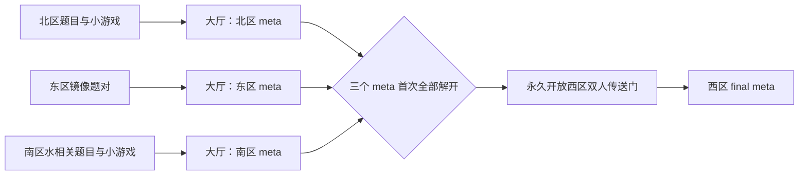
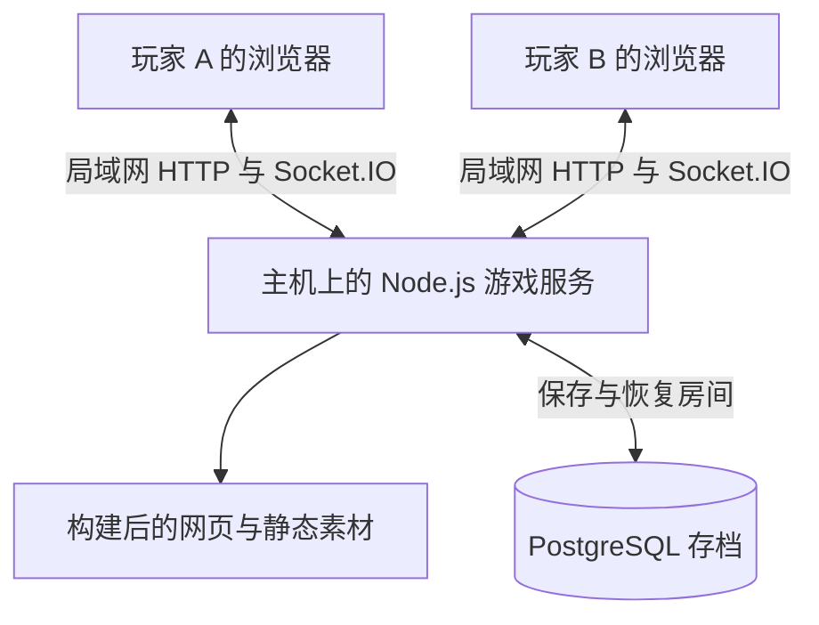

# 双人在线 Puzzlehunt — 产品与开发计划

版本：v0.12  
日期：2026-10-27  
阶段：占位试玩版与局域网直连配置完成；规则、真实数据库联机、备份恢复与 LAN 双会话自动化联机已验证，真实两台玩家设备的局域网完整试玩待验收。用户因穿透延迟决定停用公网隧道。

本文以用户给出的玩法为基础，作为后续设计地图、编写谜题和开发程序的依据。用户明确要求的玩法保持不变；原需求未涉及的操作边界与技术细节，按本文标明的工程决策执行，不冒充用户原话。第 1.1–1.5 节记录最新区域设计，具体谜题尚未定稿的机制保留为内容设计工作。里程碑区分当前已实现的占位版与下一阶段区域机制，不能把设计完成视为代码已经实现。

## 1. 产品目标与首版范围

制作一款供两名玩家使用两台设备在线合作的 Puzzlehunt。两人加入同一个房间，也就是同一个持久化存档；各自控制一个角色，在五张网格地图中移动、解谜和交互。

交付形态是一个可访问的网站：两名玩家在各自浏览器打开同一网站，通过房间码或邀请链接进入同一场游戏。玩家不需要安装游戏、启动本地服务器或配置自己的路由器。用户已确认第一次上线只需要一组两名玩家；服务端保留房间边界用于存档与身份校验，但不把多组同时游玩作为首版交付条件。

核心体验是：**共享世界与解谜结果，各自操作角色、谜题窗口和对话窗口。**

首版必须完成：

- 双人加入同一存档、选择不同角色、断线后恢复原角色。
- 东、南、西、北、中五张地图；游戏中每台设备同时只展示一张地图。
- 正交网格移动、格间墙、推动另一名玩家。
- 站在谜题格按 V 打开题目，独立填写并提交答案。
- 解题状态与锁状态实时共享；已解题允许覆盖答案，也允许重新变为未解开；题目支持双解或多个正确答案。剧本相关附加影响在内容明确后接入，不阻塞当前首版。
- 由题号控制的锁，以及随解题状态发生的解锁和重新上锁；玩家脚下重新上锁时被困原地，须再次解开对应题目才能恢复移动。
- 两名玩家同时占据同组两个传送门后，按固定对应关系共同跨图。
- 面向交互对象按 X 打开个人对话，再按 X 关闭。
- 任一玩家解开 final meta 后达成通关，仍可继续移动、交互和修改答案，探索其他解法。

首版范围不包含聊天、语音、排行榜、观战、账号注册、道具背包、关卡编辑器和手机触屏。用配置文件制作地图与谜题；验收环境为两台带键盘的电脑、当前稳定版 Chrome 或 Edge，视口至少 1024 × 768。无需先补齐其他设备的适配。

**素材安排已确认：正式贴图由用户后续上传，当前使用简单几何图形占位，不等待贴图到齐再开发。** 占位图形仍须完整表达角色区分、题号、锁号、面向和传送组关系；后续替换贴图不改变碰撞与玩法规则。

**内容安排已确认：正式剧本和关卡尚未创作，首版全部使用明确标注的测试题、占位角色、占位对话和五图测试布局。正式内容不是本次上线的前置条件。**

### 1.1 区域结构（用户最新设计）

五张主地图分别承担以下职责：

| 主地图 | 内容与用途 | 已确定的区域机制 |
| --- | --- | --- |
| 中区／大厅 | 汇合与往返枢纽，摆放北、东、南三区各自的 meta 题 | 区域 meta 是大厅中三道独立题目，分别保留题号、答案与解题状态 |
| 北区 | 若干分成不同部分的题目／小游戏 | 每部分各有填写答案的位置、自己的答案与独立通过状态，复用现有题目机制 |
| 东区 | 成对组织的题目／小游戏 | 每对题目的答案具有镜像关系 |
| 南区 | 若干题目／小游戏 | 与水相关；水的具体交互形式尚未确定 |
| 西区 | final meta 所在区域 | 北、东、南三个 meta 首次全部解开后，通往西区的传送门永久开放 |

各区域可包含小房间、箱庭或大空间中的题目／小游戏，不要求所有题都以相同空间形态出现。题目数量、区域名称、题号、题面、正式布局和贴图仍按后续内容配置。



图中区域题目指向 meta 表示内容上的汇总关系，不自动意味着“必须把区域全部小题答对才能打开 meta”。**当前编排建议**是北、东、南三区可并行探索，大厅三个 meta 可提前查看；具体题目需要的线索依赖随出题确定，不自行加解题顺序或小题全清限制。

### 1.2 西区入口的永久开放（用户已确认）

用户明确选择：“首次全部解开后永久开放”。服务端增加独立的持久化进度，例如 `milestones.westUnlockedAt`：

```text
当一次答案提交完成后：
  若 westUnlockedAt 为空，且 northMeta、eastMeta、southMeta 当前均 solved：
    westUnlockedAt = 本次服务端时间
西区入口是否开放 = westUnlockedAt 非空
```

“首次全部”指三个 meta 在某个时刻同时处于已解状态；如果一题答对后又改错，再解另外两题，不算同时集齐。三题首次集齐之后，改错、切换正确解、刷新、断线或进程重启均不关闭西区入口。三个 meta 自身仍可改回未解，已有各题答案不被清空。

该进度和首次 final 通关记录分别保存。普通题号锁仍按照控制题的当前状态开关，不能将西区永久进度套用到所有锁上。入口里程碑在答案提交的同一事务中保存，保存成功后再向两端广播；客户端不能自行宣布门已开放。

西区入口使用传送组的启用条件，不在门格上叠加普通题号锁。尚未开放时显示关闭状态及三个 meta 的完成情况；门位仍是可站立路径，但站齐不能传送。开放后保留现有两人同时站齐、固定配对、共同换图及防止落地立即返传的规则。开放本身不搬动角色，须按原站齐触发流程进入；解锁后的往返均可使用。

### 1.3 三个区域需要的题型支持

**北区：每个部分就是一道独立可提交的题，复用现有机制，不新增开发。** 用户补充确认：题目的每一部分各自有一个能填写答案的位置、自己的答案；提交正确答案仅让该部分通过，与另一个部分无关。

内容配置中给每个部分独立的题目 ID、题号、题干、答题位置与答案规则，例如 N1-A、N1-B；它们可以在内容上同属一组，但不需要新的组合判定、整题通过标记或专门的分部分提交接口。两人各自在对应题目处按 V 打开不同题干，使用现有的独立窗口和普通答案输入框提交；不新增按角色分配题干或限制某部分只能由指定角色提交的权限机制。

例如 A 答对、B 未答时，A 已通过、B 未通过；B 随后答错不撤销 A。按原有答案覆盖规则，A 自己从正确改为错误，只改变 A 的状态，不影响 B。各部分的已提交答案和进度仍由两人共享，未提交草稿保持个人独立。若某部分控制普通题号锁，锁只跟随该部分的当前状态。大厅北区 meta 仍是一道单独提交的题，不由这些部分自动合并判定。

**东区：保留题目配对与答案关系。** 配置记录哪些题是一对，两题各自保留题号与答案状态。用户目前确定的是“答案互为镜像”，尚未确定镜像作用于文字、图形、坐标还是其他结构，不能直接等同于倒序字符串，也不预设整张地图镜像或操作反向。固定答案可以先由内容体现关系；若一对题存在多解，且不同正确解不能随意组合，再为该对声明服务端组合判定。

**南区：水作为机制主题。** 需要能保存、同步区域环境或小游戏状态，但暂不锁定具体水机制。后续可选的出题方向包括水位改变通路、阀门与流路配合、水流影响物体；这些是设计候选，并非同时纳入开发范围。先确定一个具体题例，再决定状态字段和操作。若最终需要水位，优先考虑离散水位档位；当前不建设连续流体模拟、自动计时涨水或泛化物理引擎。

### 1.4 小房间、箱庭与小游戏的组织

当前工程建议保持五张主地图，以三种方式承载区域内容：

- **地图内小房间**：使用该区同一网格上的墙、路径和入口围合；玩家可各自进入不同小房间，仍处于同一张共享主地图，不增加一套跨图规则。
- **大空间中的谜题／交互**：题号格按 V 开题；环境中的操作对象沿用面向并按 X 的交互入口，具体控件由题目定义。
- **需要独立界面的小游戏／箱庭**：在个人窗口中加载专门的交互界面；共享棋盘、环境状态或通关结果由服务器保存，镜头、当前窗口和未提交草稿各自独立。小游戏窗口与主地图场景是两种不同的内容容器，不能只靠一段 Markdown 代替交互逻辑。

这样可以实现一个区内的多个小空间，同时保留“两人通过双人传送共同切换主地图”。如果正式设计确实需要走门后切换成另一张独立网格的小房间，再扩展区域与场景模型，并明确两人能否分处不同场景；不默认改变当前共同地图规则。

题目身份、所在区域、所在空间、题型和答案结构分别配置。区域不等同于题型：同一区可混排文字题与小游戏，区域特色不强制套在每一道题上，除非出题另有要求。每个小游戏实例按存档与实例 ID 隔离，操作与进度走现有服务端顺序处理、去重和保存流程；不引入可执行任意题面脚本的通用引擎。

### 1.5 与当前程序的关系

新房间默认使用 `demo-v3`：大厅三 meta、西区 final、北区两间独立题室、东区左右成对题位、南区水池与步道，共五张 11 × 9 地图、十道占位题和四组双人门。西区门已有三区 meta 前置条件及永久开放记录。旧 `demo-v2` 继续供已有房间加载，旧版测试 final 仍在东图；不原地搬动旧房间，查看新版需要创建新房间。

北区已配置 N1-A / N1-B 两道普通题，各有答题位置、答案和通过状态，不增加新题型、接口、合并判题或角色专属提交权限。东区当前仅以左右对称布局和题面说明标出题对，尚未加入配对判定数据；南区水池为静态不可通行格。正式镜像表达、水交互和小游戏在明确题例后按需实现，见 M7。正式故事、题量与贴图仍由后续内容替换。

## 2. 玩家流程与界面

### 2.1 加入同一存档

采用「创建房间 / 输入房间码加入」流程：

1. 玩家 A 创建房间，获得房间码和邀请链接。
2. 玩家 B 在另一台设备输入房间码或打开邀请链接。
3. 确认加入后，服务端为玩家保留一个席位，每个房间最多两个玩家席位；仅浏览邀请页面不占位，避免链接预览提前占满房间。
4. 每人确认进入后看到角色选择界面，上方显示 **“我是谁？”**，下方是两个角色按钮。
5. 玩家只能选择尚未被占用的角色；两人同时选择同一个角色时，服务端只允许一个请求成功。
6. 两人都选定角色后共同进入地图；先完成选择的一方看到等待同伴提示。角色一经进入游戏即绑定席位，首版不提供中途换角。角色名称、外观、初始位置由内容配置提供。

两台设备可以来自不同 IP，也应允许处于同一个 Wi-Fi 下。IP 用于网络连接，不作为玩家身份或房间归属的依据。房间码负责加入，独立的会话凭证负责恢复玩家身份。

第三名玩家不能进入已满房间。刷新页面或网络重连不新建席位，不重置角色与存档。创建、加入、选角都须防止重复请求和并发占位，不能出现两个请求同时占用最后一个席位。

创建和加入之前先建立匿名浏览器会话，并确认同源 Cookie 可以正常使用。创建/加入请求使用该会话与一个预先保存在本地的 `entryRequestId` 去重；响应丢失后按原 ID 查询或重试，返回原房间及席位，再读取该房间的当前快照，不回放过时的地图状态。此时还没有房间内的玩家身份，不能套用“房间 + 席位”的去重键；也不能在创建成功后才首次建立浏览器身份，否则首个响应丢失就可能无法认领已经创建的存档。

房间阶段固定为 `waiting → active → completed`。`waiting` 只接受加入、身份恢复、选角和同步，不接受移动、开题、NPC 交互或答题；第二名玩家选定剩余角色时，在同一次事务中切换到 `active`，按角色配置放置两人。新存档中每题的当前答案和正确解 ID 都为空、`solved=false`，所有题号锁关闭，个人窗口为空，首次通关记录为空；只在首次开始时初始化，刷新或服务器重启不能重复初始化。通关后保持 `completed`，玩家离线或 final 改错都不会退回等待状态。

同一席位的多个浏览器标签不能同时获得控制权。新标签发现该席位仍由其他连接控制时，显示“此角色已在另一处打开”，提供“接管此角色”按钮；只有持有该席位有效凭证的玩家可以接管。正常重连延续原控制会话，旧连接被接管后不能靠自动重连夺回控制。服务端用递增的 `controlEpoch` 区分控制代次并拒绝旧连接的操作，避免两个标签不断互相抢控制权。

身份与续玩规则：

- 创建房间后，网页提供复制邀请链接和房间码的按钮，由玩家自行分享。
- 房间码负责定位并加入未满的房间；加入后，服务端签发独立会话，用 HttpOnly Cookie 识别当前浏览器，服务端再查询其房间与席位。正式部署设置 `Secure`、`SameSite=Lax`、`Path=/`，HTTP 修改请求和实时握手均校验同源。会话过期时使用恢复码续玩，不重新占位。
- 邀请链接不包含创建者的会话凭证。拿到同一个邀请链接，不等于能控制已被占用的角色。
- 两人离线不删除房间或释放已绑定的角色；下次使用原浏览器继续原存档。
- 提供每个席位独立的恢复码，首次加入时让玩家保存；更换设备或清除浏览器数据后用它取回原席位，房间码不能单独取回已占用席位。
- 使用恢复码在新设备接管时更新凭证与控制代次，使旧设备失去操作权限；恢复码不能通过普通邀请链接或公开房间状态获取。
- 创建房间的玩家只是第一名加入者，不承担服务器职责；其离开不终止网站或清除共享存档。

### 2.2 游戏主页面

主页面包括：

- 当前地图名称与网格区域。
- 两名角色及各自面向；外观区分玩家，能力完全相同。
- 地图上的题号、锁号、墙、传送门和交互对象。
- 简短操作提示，以及自己与同伴的连接状态。
- 解题状态变化、传送、通关等必要反馈。

地图中的世界状态由两台设备共享，但窗口大小、缩放、焦点、滚动位置、答案草稿和当前打开的界面各自独立。

由于跨图只能通过双人传送完成，正常游戏中两名角色始终处于同一张地图。地图切换是共同世界状态变化，不提供单人自由切换地图的功能。

### 2.3 谜题界面

参考用户提供的 [pnku3 空悬蛛网静态版](https://pnku3-day4-web.pkupuzzle.art)。2026-10-27 已下载并追踪公开 JavaScript 与 CSS，确认它使用 React 和 Ant Design：谜题是约 720px 宽的居中弹窗，顶部为题名与状态，包含“题目 / 提示 / 提交记录”标签页，题目页以图片展示题面，底部为答案输入和提交区。提交回调、本地判题和存档逻辑已完成代码核对。

参考站的组件与 CSS 已足够确定布局借鉴范围。本项目不要求逐像素复刻，删除“必须先取得参考站截图”的前置任务；实际界面验收对象为我们自己的页面。参考站没有成功取得截图的事实及源码证据保留在 [参考站核对记录](research/PNKU3_REFERENCE.md)。

谜题界面包含：题号、标题、题面正文、图片或附件、答案输入框、提交按钮、判定反馈、共享的当前已提交答案，以及关闭入口。

沿用参考站「顶部题名与状态、主体题面、底部答案区」的组织方式：弹窗宽度为 `min(720px, 100vw - 32px)`，最大高度 `90dvh`；题面独立滚动，输入区保持可见。图片不超过题面宽度，允许在独立查看器查看原尺寸；正文使用系统字体、16px 字号和 1.6 行高。提示页、二次提交确认和完整提交历史表不列入首版。

- 只有按 V 的玩家打开界面；另一名玩家不被强制打开、关闭或跳转。
- 两人可以同时打开不同题目，也可以分别打开同一道题。
- 一个人提交后，两人看到的该题当前答案和解题状态更新；另一人的未提交草稿不被覆盖。
- 长题面与长图不得遮挡答案区；打开图片查看器不丢失题面草稿或开题资格。
- 解开后保留题号，增加已解标记；允许再次打开和提交答案，不替换统一题号方块。
- Esc 或关闭按钮退出题目；输入框中的 V、X、WASD 和方向键按文本编辑规则处理。

### 2.4 交互界面

任一玩家面向相邻交互对象，按 X 打开自己的交互界面。首版支持一条对话，再按 X 关闭，回到地图操作。

另一名玩家不受对话窗口影响，可以继续移动、开题和提交答案。首版对话为配置中的一条占位文本，不提前制作条件分支、选项、奖励或剧情变量。

## 3. 地图与对象规则

### 3.1 坐标与地图配置

- 五张地图分别使用 `east`、`south`、`west`、`north`、`center` 标识。
- 每张地图有独立宽高，使用整数坐标 `(x, y)`；约定右为 x 增大、下为 y 增大。
- 网格由等大的正方形组成；移动只允许上、下、左、右，不允许斜向移动。
- 有效路径之间可以通行；空白格、地图外部不能进入。
- 地图尺寸、路径布局、题目数量、出生点、final meta 位置和五图连接关系均由内容配置决定。开发使用第 11 节的样例；正式内容输入见第 14 节，不在代码中写死。

地图数据按基础格、格间墙、格上对象分别描述，避免用一张贴图同时承担全部碰撞与显示规则。

### 3.2 元素表

| 元素 | 占用方式 | 通行规则 | 显示与操作 |
| --- | --- | --- | --- |
| 路径 | 一个格子 | 相邻且无墙、无阻挡时可进入 | 普通路径方块 |
| 谜题 | 路径上的一个格子 | 题目本身不阻挡通行 | 统一谜题方块与题号，站上去按 V |
| 墙 | 两个相邻格之间的一条边 | 阻止双向穿越该边 | 沿格边绘制 |
| 锁 | 一个路径格，可覆盖谜题 | 对应题目未解开时不可进出；原地玩家被困，不能自行离开或被推出 | 统一锁贴图与控制题号 |
| 传送门 | 路径上的一个格子 | 可站立；满足双人条件时共同传送 | 显示门的组别与对应位置 |
| 交互对象 | 一个格子 | 不能进入，也不能推动 | 朝向它按 X 交互 |
| 玩家 | 一个可站立格子 | 遇到另一玩家时尝试推动 | 两种外观，相同能力 |

锁打开后，其所在路径恢复通行，底层谜题仍可显示和打开。锁的控制题号与被覆盖的谜题题号可以不同，配置中必须区分两者。一个题目可以控制多个锁。

支持「路径 + 谜题 + 锁」组合，每格最多一道谜题和一把锁。传送门及 NPC 不与谜题、锁或其他同格对象重叠；配置校验器拒绝不支持的重叠。

### 3.3 墙

墙存储为一对正交相邻坐标构成的无向边。`A—B` 与 `B—A` 是同一堵墙，不存成两份互相独立的数据。

移动和推动均检查经过的每条边。墙不占格子，不能用不可通行方块替代格间墙的语义。

### 3.4 占位图形与后续贴图替换

当前用 CSS / SVG 绘制简单图形，不需要提前制作或生成正式美术资源。占位方式如下：

| 元素 | 当前占位图形 |
| --- | --- |
| 路径 | 浅色正方形 |
| 墙 | 格间深色线段 |
| 两名玩家 | 不同颜色的圆形，配 1 / 2 标识与面向小三角 |
| 谜题 | 统一样式的醒目正方形，叠加题号 |
| 锁 | 统一样式的方框与锁定符号，叠加控制题号 |
| 传送门 | 圆环，标注组别与对应位置 |
| NPC 等交互对象 | 菱形或方形，配简短文字标识 |

题号、锁号和角色标识单独作为文字层绘制，避免替换图片后丢失。对象通过资源键引用外观，资源未提供或加载失败时继续显示占位图形；用户上传贴图后只替换资源映射和显示参数。网格坐标、墙的位置、占格大小和可通行判定始终由逻辑数据决定。

## 4. 移动、朝向与推动

### 4.1 基础移动

玩家使用 WASD 或方向键，每次有效操作移动一格。服务端根据当前世界状态判断结果，客户端不能直接指定或修改自己的最终坐标。

从 A 格向 B 格移动时：

1. 检查 A 是否有关闭的锁；若自己被锁在原地，不执行位移。
2. 检查 B 是否在地图内且为可通行地块。
3. 检查 A 与 B 之间是否存在墙。
4. 检查 B 是否有关闭的锁或交互对象。
5. B 没有玩家则移动；B 有另一名玩家则执行推动判定。

以上条件不满足时，不改变位置。方向键即使未造成位移，也更新角色面向，使玩家能够面向不可进入的 NPC；位置变化与面向变化分别判定。

被推动的玩家面向不变。按下方向键立即请求一步，持续按住时每 150ms 请求一步；同时按多个方向时采用最后按下且仍未松开的方向，不产生斜向移动。频率作为统一配置参数，调节它不改变碰撞规则。

### 4.2 推动另一名玩家

设当前玩家在 A，另一名玩家在 B，推动方向的下一格为 C：

- 同时检查 A→B、B→C 两条边和 A、B、C 的锁状态；A 或 B 上的玩家被锁住时，不能发起有效推动或被推出。
- C 必须是有效可进入格，不能越界、没有路径、被锁、被 NPC 占据或隔着墙。
- 全部成立时，一次性把当前玩家移到 B，把另一名玩家移到 C。
- 任意检查失败，两人的位置都不改变。
- 不允许先移动一人、后发现另一人不能移动；任何时刻不能出现两人重叠占格。

两人同时发出移动请求时，由服务端按接收顺序逐个执行，不尝试让两个请求各自基于旧坐标同时生效。

### 4.3 窗口打开期间的行为

- 自己打开谜题或对话时，自己的方向键不再发送行走命令，避免编辑文本时走动。
- 世界继续运行，在通行与锁规则允许时，另一名玩家仍可推动自己，也可能触发共同传送。
- 已经合法打开的题面或对话保留，并提示角色位置或地图发生变化；不因队友移动而丢失答案草稿。
- 谜题允许在这次已打开的界面中继续提交；关闭后，重新打开仍须站回对应谜题格按 V。
- 服务端记录每名玩家当前合法打开的题目；不能通过手动构造请求任意打开未到达的题目。
- 当前合法打开的题目按席位持久化；刷新、重连或服务重启后恢复这一题的窗口与提交资格，即使玩家已被推动、传送或困在锁格。只恢复当前窗口，不授予远程重开所有已见题目的能力。
- 玩家主动关闭后清除这次打开资格；再次打开仍须站回题目格。打开、关闭与提交进入同一房间队列，关闭请求携带对应的窗口标识，迟到的旧关闭请求不能关掉新窗口。
- 对话也只恢复本人的当前对象及配置中的文本。草稿按房间、席位、题目存放在本地，不作为服务器存档，也不承诺自动迁移到另一台设备。

每个席位同时至多拥有一个题面或 NPC 窗口。个人窗口另有单调增加的 `viewRevision`；打开和关闭均增加该版本，关闭后的空窗口也保留版本号。客户端只应用当前存档代次内较新的个人窗口状态，不能因为公共地图 `revision` 未变而忽略关闭，也不能让迟到的旧开题响应重新弹窗。

关闭动作以服务端确认清除资格为准。网络等待期间允许先隐藏窗口，页面显示“正在同步关闭状态”，本人暂不恢复移动；队友仍可正常操作。若有未确认的答案，先核对该提交结果，再发送关闭；断线时保留原 `viewId` 与关闭请求 ID，重连后只关闭仍匹配的原窗口，不影响已经变更的新窗口。完成确认或同步到窗口已关闭后，才恢复自己的地图按键。

地图切换或本人被推动时显示不抢焦点的位置提示；这些行为按验收场景测试，不再作为未决定的规则。

## 5. 谜题、答案覆盖与共享影响

### 5.1 答案判定

题目配置包含题号、标题、公开题面和服务端私有的答案判定规则。标准答案不放入前端资源、公开地图配置或共享状态消息。

题目可能有双解，因此判定规则必须支持一个或多个正确答案；不把每道题限制为单个答案字符串。任意一个配置为正确的答案都使该题处于已解开状态，另一个正确答案可以覆盖当前正确答案。这一规则同样适用于 final meta，并在通关后继续生效。

服务端为不同解法保留稳定的 `answerVariantId`，区分「同一答案的写法别名」和「不同正确解法」。当前首版中所有正确解都使题号锁保持打开，不预设解法专属剧情。

默认只去除答案首尾空白；每题用 `trim`、`caseFold: none | upper`、`removeInternalWhitespace` 指定规范化规则，再与 `acceptedAnswers` 中使用同样规则处理的答案比较。默认保留内部空白和标点，不做全半角转换。题目配置可以列出别名；原始输入单独保存用于双方显示。

规范化后为空或原始输入超过 256 个 Unicode 码点，属于格式错误，不覆盖已有答案；格式有效但判定错误的答案必须覆盖旧答案。同一玩家同时只保留一个正在确认的提交；确认后即可继续提交，没有答错冷却。

| 提交前 | 新提交 | 提交后 | 共享影响 |
| --- | --- | --- | --- |
| 未解开 | 正确 | 已解开 | 解锁对应锁 |
| 未解开 | 错误 | 未解开 | 保存这次答案，保持未解状态 |
| 已解开 | 正确（同一解或另一解） | 已解开 | 覆盖当前答案，更新当前解法，锁保持打开 |
| 已解开 | 错误 | 未解开 | 覆盖当前答案，重新锁定 |

提交失败后没有谜题冷却、次数惩罚或等待计时，可以马上再次提交。单次提交等待服务端确认是网络状态，不是答题冷却。

### 5.2 两人同时提交

每道题只有一个共享的当前答案。两人的请求按服务端接受顺序串行处理，后一次有效提交覆盖前一次。北区各部分使用不同题目 ID，直接沿用本规则：提交 A 只更新 A，提交 B 只更新 B；不增加两部分的合并判定。

每次提交携带唯一请求标识；网络重试同一个请求时只生效一次，不能把已经处理过的旧答案重新覆盖到较新的答案上。

已提交请求的回执必须在重新检查“当前是否还开着该题”之前查询：例如答案已入库、确认丢失、玩家随后关闭题面，按原 ID 查询仍应返回原提交结果。仅新的、未处理的请求才需要重新满足当前开题条件；身份和存档代次检查始终先执行。

如果甲提交正确、乙随后提交错误，该题最终必须是未解开，并在两台设备上显示一致结果。个人草稿与共享已提交答案使用不同字段，更新时不能混淆。

### 5.3 锁与其他附加影响

普通锁的状态直接由控制题目的当前解开状态决定：

```text
lock.isOpen = puzzleStates[lock.controllerPuzzleId].solved
```

不要分别维护一份可被独立修改的「锁已经打开」永久标记，否则答案改错后会出现谜题与锁状态不一致。

用户已确认剧本相关影响视后续内容而定。普通题号锁机制保持不变；`demo-v3` 已增加西区永久入口进度，和答案提交在同一事务保存。新版布局暂不放普通锁，旧版仍保留锁与救援样例。其他条件台词、剧情分支或通用脚本引擎仍不提前开发。南区环境变化在具体水机制确定后按题目实现。

普通锁从当前完整题目状态计算，新增效果须明确是否可撤销。任意答案覆盖都不清除其他题的已提交答案。西区入口首次开放与首次通关是两个分别保存的永久结果，见第 1.2、10 节；不能只靠当前答案重新推算它们。

### 5.4 玩家脚下重新上锁（已确认）

这个情况来自两条确定规则的组合：解题后锁格可进入；正确答案可以被错误答案覆盖并使锁重新关闭。

例如：甲解开第 1 题 → 乙进入原本由第 1 题锁住的格子 → 甲将第 1 题改错 → 乙仍站在该锁格上。

按用户确认，乙被锁在原格，必须依靠重新解开对应题目获救：

- 锁立即关闭，不等待乙离开；不将乙自动移走、送回出生点或回退至安全格。
- 该格视为四边封闭。乙不能主动走出，甲也不能进入该格或将乙推出；失败的推动不改变任一玩家位置。
- 任意一名玩家再次正确提交控制该锁的题目，锁恢复打开，乙恢复正常移动。
- 被困不取消合法的答题操作：已打开的题面仍可提交，脚下若有谜题仍可按 V 打开；不能因此远程打开任意题目。
- 玩家位置和题目状态共同决定是否被困；刷新、断线重连或服务器重启不会自动脱困。
- 通关后仍执行相同规则。改错答案照常重新上锁，解开控制题照常放人。

正式地图须检查每处锁及可同时关闭的锁组合，记录一人或两人被困时的合法救援路线；不能只依赖玩家一直不关闭某个题面。发现无解状态时修改正式地图或锁布局，不能通过自动放人、回城或重置位置修补。首版采用静态配置检查加人工救援用例，不额外开发通用关卡求解器。

## 6. 双人传送门

### 6.1 组与一对一映射

每组恰好包含四个门，分属两张不同地图，每张地图各两个。以一组为例：

```text
地图一：A、B       地图二：C、D
固定对应：A ↔ C，B ↔ D
```

当两名玩家分别站在同一侧的 A、B 时，在一个操作中把 A 上的玩家传到 C、B 上的玩家传到 D，并共同切换当前地图。返程采用相同映射。

映射依据门的位置，不依据角色身份；两人交换站位后，抵达位置也随之交换。

### 6.2 触发条件与执行顺序

- 单人站在一个门上不触发。
- 两人站在不同组的门上不触发。
- 两人必须分别占据同组、同地图的两个门。
- 普通移动或推动完成后检查传送条件；推动形成正确站位同样触发。
- 两人的坐标和当前地图必须一起变更并一起保存，两台设备不能只传走一个人。
- 传送终点应在地图配置验证时确保有效、互不重叠、可站立。

### 6.3 防止抵达后无限来回传送

按持续占位直接判断会导致 A/B → C/D → A/B 无限往返，因为抵达时两人仍站在同组的两个门上。

使用重新触发条件：一次传送后，抵达侧暂时不能再次触发；至少一名玩家离开门，使双人占位条件中断，然后重新站齐，才允许返程。不是时间冷却，也不改变门的一对一对应关系。

需要保存这个触发状态，刷新或服务器重启不能造成自动返传。首版不允许两个传送组共用一个门格，以避免同一步触发多个组的歧义。

## 7. 交互对象与按键优先级

NPC 或其他交互对象占据一个格子，不能进入、穿过或推动。

打开交互时检查：自己与对象正交相邻，自己的面向指向对象，中间没有墙，自己脚下也没有关闭的锁。锁格四边封闭，因此不能从中发起新的隔边 NPC 交互；已打开的个人窗口继续遵循第 4.3 节。

按键处理优先级为：

1. 输入框或可编辑区域有焦点时，按文字编辑处理。
2. 谜题界面打开时，处理答题、关闭等操作，不发送移动与 NPC 交互。
3. 对话界面打开时，X 关闭对话，不发送移动。
4. 无覆盖界面时，处理 WASD / 方向键、V、X。

打开与关闭界面的 V、X 只响应一次按下，忽略长按重复事件，防止一次长按立即打开又关闭。窗口失焦、打开覆盖界面或断线时清空持续按键状态；返回网页不会继续走动。输入法组合输入期间的回车不触发答案提交。

## 8. 共享状态与个人状态

| 状态 | 归属 | 保存与同步原则 |
| --- | --- | --- |
| 房间身份、游戏阶段、内容版本、存档代次 saveEpoch | 房间共享 | 持久化，发给房间两人 |
| 当前地图 | 房间共享 | 始终只有一个当前地图 |
| 每名玩家的位置、角色与面向 | 分别记录，共同可见 | 服务端权威保存并同步 |
| 每题当前答案、命中的正确解、是否解开、最后提交者 | 房间共享 | 一题一份最新结果，正确解可切换 |
| 锁状态 | 房间共享 | 从已保存解题进度确定性派生 |
| 传送重新触发状态 | 房间共享 | 持久化，防止重连返传 |
| final meta 通关标记与首次完成时间 | 房间共享 | 只能由服务端确认，与当前答案状态分别记录 |
| 西区首次开放记录 | 房间共享 | 三个区域 meta 首次同时正确时持久化，之后不随答案撤销 |
| 北区各部分答案与判定 | 沿用普通题共享状态 | 各部分是不同题目 ID，各自保存答案与通过状态，不互相覆盖或联合判定 |
| 小游戏或区域环境状态（后续具体题型） | 按题目定义，默认共同存档 | 服务端保存共享状态；个人视角与草稿不作为共同状态 |
| 当前打开的题目 / NPC 与 viewRevision | 玩家个人 | 按席位持久化，仅向本人恢复；合法性由服务端校验 |
| 未提交答案、滚动位置、焦点 | 玩家本地 | 不广播给队友 |
| 在线状态、当前控制连接 | 会话运行状态 | 断线更新，重连重新建立 |

「位置以外共享进度」理解为两人没有独立的解题、解锁或剧情进度；朝向、窗口与草稿属于个人操作状态，不是各自独立的游戏进度。

## 9. 首版实现方案

### 9.1 技术结构

使用 TypeScript 统一前后端数据类型：

- 前端：React + Vite，负责页面、网格和个人交互窗口；地图使用 DOM / SVG，题面使用 Markdown，禁用正文中的原始 HTML。打包后以网页静态资源部署。
- 服务端：Node.js 24 LTS，负责房间、身份、移动规则、答案判定和状态变更。
- 实时通信：Socket.IO 4.x，负责房间消息、请求确认与重连；两端使用同一锁定版本的客户端和服务端库。
- 存档：PostgreSQL 18，保存房间快照、玩家席位、题目进度与命令处理结果。
- 内容：版本化地图配置和题面资源；标准答案与判定规则独立放在服务端。

2026-10-27 已核对：Node.js 24 是受支持的 LTS 系列，满足 Vite 当前的运行要求；PostgreSQL 18 是受支持的正式版本。工程初始化使用这些主版本的受支持补丁版本，写入锁文件和容器版本，不使用漂移的 `latest` 部署。依据：[Node.js 发布状态](https://nodejs.org/en/about/previous-releases)、[Vite 环境要求](https://vite.dev/guide/)、[PostgreSQL 版本政策](https://www.postgresql.org/support/versioning/)。

React 的组件与状态模型可用于独立窗口和共享地图显示，见 [React 官方文档](https://react.dev/learn)。Socket.IO 提供双向事件、确认和自动重连，但不是原生 WebSocket 协议的同义词，见 [Socket.IO 官方介绍](https://socket.io/docs/v4/)。存档采用数据库事务保证多项状态一起提交，见 [PostgreSQL 事务文档](https://www.postgresql.org/docs/current/tutorial-transactions.html)。

### 9.2 状态变更链路

```text
玩家按键 / 提交答案
        ↓
客户端发送操作意图 + commandId
        ↓
服务端验证会话、控制权与存档代次
        ↓
查询原命令回执；未处理请求才检查阶段、位置与窗口前提
        ↓
按房间顺序执行规则，计算完整新状态
        ↓
数据库事务保存状态变更 + 对应版本 + 请求结果
        ↓
提交成功后确认请求；公共变化广播两人，个人窗口只回复本人
```

首版采用单个游戏服务实例，每个房间独立串行处理命令。数据库事务同时保护存档一致性；不增加多实例、Redis、消息队列或分布式房间调度。

计算过程只生成候选新状态；数据库提交成功后才替换内存中的已确认状态并发送结果。事务失败或回滚时保留原状态，不能先改内存、再把失败状态继续传播给下一条命令。

### 9.3 一致性与断线恢复

- 客户端只发送「向右走」「提交某题答案」等意图；服务端计算坐标、正确性、锁和传送。
- 每次共享状态变更增加房间版本号 `revision`。
- 首版广播小型完整运行状态快照，地图静态资源与题面不随每步重复发送。
- 在同一个 `saveEpoch` 内，客户端忽略较旧的公共 `revision` 和个人 `viewRevision`；重新连接时拉取公共快照和本人的窗口快照。备份恢复改变存档代次时按第 9.10 节重新建立比较基准。
- 操作成功必须先持久化再确认；数据库写入失败时不把未保存状态宣布为成功。
- `commandId` 与处理结果共同保存，防止超时重试或重启后重复处理。
- 广播丢失不等于存档丢失，客户端可通过重新同步取得已经提交的状态。
- 移动命令断网后不排队补发，避免重连后角色突然连续走动。
- 答案提交超时显示「结果待确认」，用原请求标识查询或重试，不能显示为答错。
- 网络中断时保留本地草稿，停止假装提交成功或继续修改权威坐标。
- 游戏请求以房间、席位、`saveEpoch` 与 `commandId` 为去重范围；入口请求按第 2.1 节使用浏览器会话与入口请求 ID。同一 ID 携带不同业务内容必须拒绝。已处理请求的旧确认不能用其旧版本覆盖较新的快照。
- 通关、锁与当前地图以持久化快照为准；即使错过实时通关通知，重连后仍能显示已有通关记录。

Socket.IO 默认缓存离线时发送的事件，因此移动只在连接有效、身份恢复且取得最新快照后发送，使用 `volatile` 移动事件且不自动重试；失焦或断线立即停止按键循环。答题使用单独的确认流程，待确认请求的 ID、题号与原始答案保存在本地，刷新后先查询原结果；不得把重试变成新的答案提交。首版不启用 Socket.IO 的 connection state recovery，统一重新鉴权并读取数据库快照，避免两套恢复机制相互干扰。依据：[离线消息行为](https://socket.io/docs/v4/client-offline-behavior/)、[连接恢复限制](https://socket.io/docs/v4/connection-state-recovery/)。

一人断线时角色保留原位，另一人可继续解题与移动；离线角色仍遵循相同推动规则。传送按两个角色的实际占位判断，不要求双方在线；重连直接恢复最新地图和位置。

### 9.4 最小数据模型

| 数据 | 关键字段 |
| --- | --- |
| `GameDefinition` | 内容版本、五张地图、出生点、角色定义、finalPuzzleId |
| `MapDefinition` | id、宽高、路径集合、墙集合、格上对象 |
| `PuzzleDefinition` | id、题号、标题、题面引用、私有答案变体集合与判定规则引用 |
| `LockDefinition` | id、mapId、坐标、controllerPuzzleId |
| `PortalGroupDefinition` | id、两个地图及每侧两个门、固定配对关系 |
| `NpcDefinition` | id、mapId、坐标、一条对话文本 |
| `RoomState` | roomId、saveEpoch、saveSchemaVersion、contentVersion、phase、currentMapId、mapEpoch、revision、completedAt、completedBy |
| `PlayerState` | seatId、roleId、x、y、facing；waiting 阶段位置为空，首次开始时填入角色出生点 |
| `PuzzleState` | puzzleId、当前答案、solved、answerVariantId（错误答案时为空）、lastSubmittedBy、updatedAt |
| `PortalState` | groupId、抵达侧是否已重新满足触发资格 |
| `PlayerSession` | 席位绑定、会话与恢复码的凭证摘要、controlEpoch；当前在线连接另存运行状态 |
| `PlayerViewState` | roomId、seatId、viewRevision、viewId、当前合法打开的题目或 NPC；空窗口保留 viewRevision，私有持久化 |
| `CommandReceipt` | scopeKey、commandId、业务载荷摘要、处理结果、对应公共或私人版本；scopeKey 由服务端根据入口身份或房间身份生成 |

房间数据隔离：每个请求都从有效会话确定玩家和房间，不能相信客户端传来的另一个房间号或玩家号。公开响应不包含标准答案、会话秘密和其他房间的数据。

数据库采用四组表：`rooms` 保存版本化 JSONB 世界快照，`seats` 保存两席、角色绑定、恢复码摘要及私人窗口，`sessions` 保存浏览器身份与席位关联，`command_receipts` 保存命令载荷摘要及结果。`seats` 限定席位编号只能为 1 或 2，对房间与席位、房间与非空角色分别设置唯一约束。进入同一房间的 HTTP 加入/接管请求与实时操作共用队列；事务锁定该房间行，再一次性提交席位、窗口、世界与命令结果的修改。数据库约束与事务也保护并发加入，不能只依赖前端按钮状态。依据：[PostgreSQL 行锁](https://www.postgresql.org/docs/current/explicit-locking.html#LOCKING-ROWS)。

`sessions` 可以先于房间存在，供入口请求建立稳定身份。`command_receipts` 对 `scopeKey + commandId` 设置唯一约束，创建房间及其入口回执必须一起提交。业务载荷摘要包括操作类型、目标对象、答案、窗口及地图前提，不包含会随合法重连变化的连接标识或 `controlEpoch`；更新控制凭证后核对旧请求不能被误判成“同 ID 不同答案”。

### 9.5 参考站架构核对与采用范围

已找到官方公开平台仓库 [PKUPC/pnku-website](https://github.com/PKUPC/pnku-website)，但它与所给静态版不能视为同一部署版本：

- 静态版：公开产物中的核心判题在浏览器内执行，使用 localStorage 存档；未发现答题 API 或双人实时同步。已通过集合也不会按本项目规则在答错后撤销。
- 公开完整平台：前端 TypeScript / React / Vite / Ant Design，后端 Python / Sanic，HTTP POST 处理请求，原生 WebSocket 通知前端更新数据，部分协作题使用 Yjs。核心状态由事件驱动，Reducer 与 Worker 之间通过 ZeroMQ 通信，主要数据库采用 MariaDB / MySQL。
- 本项目参考它的题面组织、内容与规则分离和状态统一推导思路；继续使用服务端权威的双人房间设计，草稿与窗口保持个人独立。
- 本节是核对结论；不直接复用参考站的判题、冷却、通关或进度保持规则。

源码位置与证据边界记录于 [参考站核对记录](research/PNKU3_REFERENCE.md)。参考站当前生产环境的主机、内部接口和运营配置不影响本项目实现，不再列为调查任务。

### 9.6 两台设备访问同一网站

初版采用同一局域网地址、单个游戏服务实例和持久化数据库：



这里的「房间」是一份逻辑存档，不是为每组玩家单独开一台服务器。游戏服务按房间区分身份、角色、命令队列和广播；两个房间不会共享进度。

路由职责：

| 入口 | 用途 |
| --- | --- |
| `/` 与 `/rooms/:roomId` | 网站首页、邀请入口与游戏页面 |
| `/assets/…` | 打包后的网页资源和公开贴图 |
| `/api/…` | 创建与加入房间、恢复身份、获取已获准查看的题面 |
| `/socket.io/…` | 角色操作、答题命令、状态同步与连接状态 |

邀请页面可通过单独的邀请标识定位房间；URL 中的 `roomId` 本身不能充当控制角色的凭证。游戏页面直接刷新时，网站入口应返回前端页面，由服务端会话恢复对应房间。

网页、API 与实时连接使用同一个主机地址和端口，由游戏服务直接提供，数据库仅供本机连接。Socket.IO 配置 `transports: ["polling", "websocket"]`：先建立长轮询，再升级至 WebSocket，升级失败仍可继续使用长轮询。心跳间隔 25 秒，超时 20 秒。若以后启用公网反向代理，需配置协议升级头及足够长的读取超时。依据：[客户端传输选项](https://socket.io/docs/v4/client-options/#transports)、[反向代理要求](https://socket.io/docs/v4/reverse-proxy/)。

本次局域网入口使用 HTTP，设置 `COOKIE_SECURE=false` 并保留 HttpOnly、SameSite=Lax；将精确的 LAN 地址加入 `PUBLIC_ORIGIN`。前端在 `crypto.randomUUID` 不可用时用 `getRandomValues` 生成 UUID。浏览器在 LAN HTTP 上缺少 Origin 与 Fetch Metadata 的同源 polling GET，使用精确 Referer 来源和 Host 校验；不放开任意来源。将来改回公网 HTTPS 时再设置 Secure Cookie。依据：[Cookie Secure 属性](https://developer.mozilla.org/en-US/docs/Web/HTTP/Reference/Headers/Set-Cookie#secure)、[Fetch Metadata 的适用上下文](https://developer.mozilla.org/en-US/docs/Web/HTTP/Reference/Headers/Sec-Fetch-Site)。

玩家两端都只连接主机上的游戏服务，不要求玩家设备彼此直连。当前必须处于能访问主机的同一局域网；不同公网网络的访问不再属于本次上线条件。

### 9.7 联机命令与状态如何分工

HTTP 用于进入游戏和获取内容；进入房间后的角色选择、移动和答案提交等操作统一通过 Socket.IO 进入房间命令处理器，避免多条修改路径使用不同规则。

以下为首版接口约定，随应用工程实现：

| 消息 | 请求或响应内容 | 是否影响队友 |
| --- | --- | --- |
| `role:claim` | 申请操作一个角色 | 更新双方的角色占用状态 |
| `player:move` | 请求向某方向走一步 | 服务端判定后更新双方坐标与面向 |
| `puzzle:open` / `puzzle:close` | 申请打开指定脚下题目 / 按 viewId 关闭当前题目 | 只更新本人的合法打开状态与窗口 |
| `puzzle:submit` | 题目、答案和唯一命令 ID | 判题后更新双方共享答案、锁与进度 |
| `npc:interact` / `npc:close` | 申请交互 / 关闭对话 | 当前单条对话只回复本人 |
| `room:sync` | 请求最新公共快照和本人窗口快照 | 在房间队列中的同一读取点取得两者，仅向请求者回复 |
| `command:status` | 按原 saveEpoch 和命令 ID 查询提交结果 | 只返回本人命令结果；同代次不存在时允许原 ID 重试，旧代次返回 STALE_SAVE |
| `view:state` | 服务端发送 saveEpoch、viewRevision、viewId 与当前窗口 | 仅恢复本人窗口，不包含队友草稿或权限 |
| `room:state` | 服务端发送 saveEpoch、revision 与完整公共运行状态 | 同步两名角色、当前地图和进度 |
| `room:presence` | 服务端发送在线状态 | 显示同伴是否在线 |
| `room:completed` | 服务端通知首次通关 | 两人收到结局提示；仍允许继续操作 |

每个请求都有单独确认结果。世界状态成功提交后，广播同一份 `room:state`，不要求客户端收到一个通知后再分别拼接多次查询，避免地图、锁和角色出现不同版本。个人题面权限、会话凭证和未提交草稿不包含在公共快照中。

游戏内修改请求统一携带 `protocolVersion`、`saveEpoch`、`commandId`、`controlEpoch`、`type`、`payload`。移动、开题、发起 NPC 交互携带 `mapId` 与 `mapEpoch`；开题与交互还携带按键时想操作的对象 ID。提交和关闭携带 `viewId`，不要求仍停留在开题时的地图。入口创建/加入请求使用第 2.1 节的身份与去重规则，此时不要求尚不存在的席位、controlEpoch 或 saveEpoch。

确认返回 `commandId`、`ok`、`saveEpoch`、`revision` 和结果或错误码；窗口变更还返回 `viewRevision`。错答案属于处理成功，返回 `ok: true, solved: false`；不能与存储失败或权限失败混淆。错误码包括 `ROOM_FULL`、`ROLE_TAKEN`、`SESSION_INVALID`、`CONTROL_LOST`、`GAME_NOT_STARTED`、`STALE_SAVE`、`STALE_MAP`、`TARGET_CHANGED`、`VIEW_REQUIRED`、`VIEW_BUSY`、`VIEW_STALE`、`INVALID_INPUT`、`COMMAND_ID_CONFLICT`、`STORAGE_UNAVAILABLE`、`CONTENT_VERSION_UNAVAILABLE`、`CLIENT_UPDATE_REQUIRED`。普通撞墙返回正常的 `blocked` 移动结果。

一个具体流程：甲站在第 1 题按 V，仅甲打开题面；甲输入时不广播草稿；提交后服务器判定并保存；若答案正确，向两人发送同一新版本，双方同时看到第 1 题已解和相关锁打开。甲随后改错，则再次计算并同步锁的关闭，包括乙因脚下上锁而被困的状态。

为避免跨图后执行旧按键，移动请求还应携带产生按键时的地图标识与地图切换代次；传送后拒绝旧代次的移动请求。同一房间的请求仍按服务端接受顺序处理，不用客户端时间戳决定谁先操作。

来自失效控制代次的请求拒绝执行。新开题和 NPC 交互必须按执行时的位置、朝向、地图代次和目标 ID 检查；因被推或传送导致目标不匹配时返回 `TARGET_CHANGED` 或 `STALE_MAP`，不能替玩家打开新位置上的另一题。已合法打开的窗口继续有效；重复打开同一个当前对象返回现有窗口，已有其他窗口则返回 `VIEW_BUSY`。客户端禁用移动之外，服务端也拒绝本人窗口打开后收到的新移动命令。`revision` 用于比较快照新旧，不因为队友刚刚移动就拒绝本人的所有正常操作。

Socket.IO 的自动重连不等于业务消息一定送达，因此仍要实现命令去重、持久化确认和重连取快照。按键断网后不缓存补发；答案请求超时则保留原命令 ID 核对结果。依据：[Socket.IO 消息送达保证](https://socket.io/docs/v4/delivery-guarantees/)。

### 9.8 代码如何拆分

项目目录按以下职责建立；当前未创建应用代码：

```text
apps/web/            页面、地图绘制、键盘输入、个人题面与对话
apps/server/         会话、房间队列、规则计算、判题、同步和持久化
packages/protocol/   前后端共享的消息类型与公开数据结构
content/public/     地图与题面源数据，按权限返回，不整体挂载为静态目录
content/assets/     不含答案的贴图等公开资源；受限题面附件通过 API 返回
content/private/    标准答案与判题规则，仅服务端读取
```

服务端规则计算集中在可独立调用的函数中：给定当前房间状态与一个合法命令，计算新状态和需要回复的结果；网络层负责身份与收发，数据库层负责保存。这样移动、推人、反向上锁和传送可以在没有浏览器时独立验证。

前端分别维护服务端公共状态和本人的界面状态。收到公共快照时更新地图与进度，不重置本人的题面、输入草稿或滚动位置。共享类型包只包含公开结构，不能把标准答案随着前端打包发布。

### 9.9 部署与第一阶段验证

用户最终选择局域网直连：开发机运行单个游戏服务与 PostgreSQL，游戏服务监听局域网，提供构建后的网页。数据库仅监听回环地址，Vite 开发端口不对外分享。主机、数据库和游戏服务保持运行即可，不需要 Docker、域名或云服务器。`npm run lan:configure` 自动配置当前局域网入口，修改后重启游戏服务。换 IP 后通过恢复码继续旧存档。Cloudflare 隧道已停止；长期公网托管的 Compose 材料保留为备用。当前操作说明见 `docs/LAN.md`。

需要上线的是前后端和数据库组成的完整服务；仅上传前端 HTML、JS、CSS 不能完成服务器判题和共享存档。数据库数据放在持久化卷中，更新网页或重启游戏进程不重置房间。双方关闭网页后不再有按键操作，服务器仍保留存档。

开发和验收按以下顺序推进：

1. 本地用两个隔离的浏览器会话模拟两名玩家，验证创建、加入、抢选角色、移动和恢复。同一浏览器的普通标签页可能共享 Cookie，不能作为两个玩家身份的唯一测试方式。
2. 在 M1 阶段提供局域网联机地址，两台玩家电脑连接同一可互通网络，验证加入、同步和刷新恢复。
3. 在同一条可联机链路上加入墙与推人，再加入一道题及其锁，验证正确提交和改错后的双端状态。
4. 再启用完整五图占位布局、传送门和 NPC，避免到最后才发现双设备联机或恢复流程不可用。

局域网双设备验收除了正常游玩，还应覆盖浏览器后台再返回、断网重连、游戏服务重启和房间链接直接刷新。发现版本落后时主动重新同步，不能以其中一个客户端的本地缓存覆盖服务器存档。房间权限隔离用自动化请求检查，不要求四名玩家同时在线。

按用户最新确认，首版验收规模固定为一个房间、两个玩家，使用处于同一可互通局域网的真实双设备。持续运行 30 分钟，记录操作确认与双端状态更新时间，正常连接期间不出现持续超过 1 秒的状态分歧。这个数值是待实测的验收目标，不是当前已取得的性能结果。删除多房间并发规模调查和容量压测任务。

本机 PATH 中的 Node.js 为 25.4.0，Docker 客户端已安装，但 Linux 引擎未能启动。2026-10-27 已在项目中安装隔离的 Node.js 24.22.1 和原生 PostgreSQL 18.4 开发进程，运行前后端与数据库，不修改其他项目的默认 Node。Docker Compose 部署材料保留，待实际部署主机验证。

### 9.10 更新内容与维护存档

区分三种版本：`contentVersion` 表示地图和题目内容，`saveSchemaVersion` 表示存档结构，`protocolVersion` 表示前后端消息格式。它们不与每次操作增加的 `revision` 混用。

`saveEpoch` 另用于标识房间存档的一次连续历史，新建时生成并持久化，普通重连和进程重启不改变。恢复旧备份会使各版本计数倒退，因此恢复流程先停止游戏服务、恢复数据，再为恢复的房间生成新 `saveEpoch`，最后开放连接。客户端只从当前已认证连接的完整同步响应接受新代次，重新采用其中的公共和个人版本基准；旧连接消息与旧代次命令全部失效。保留本地草稿，但不自动补交旧代次中未确认的答案或关闭请求，显示“存档已恢复，请核对当前进度”。

- 每个房间固定使用创建时的内容版本。新房间可以使用新版，旧房间继续读取保留的旧版地图、题面和判定规则；不能直接用新坐标布局解释旧存档。
- 首版不开发把游玩中的房间自动转换为新地图的功能。旧房间沿用旧内容，新内容用于新房间，不静默清空或重置。
- 部署新代码时执行明确的存档迁移。遇到不兼容的旧网页，提示更新并先保留草稿，停止提交不兼容的命令。
- 首版不自动删除房间。当前实现每小时用 PostgreSQL 一致性只读事务导出四张应用表为 JSON，附校验和、内容版本哈希；发布或存档结构迁移前额外导出，保留最近七天备份。这替代早期计划中的 `pg_dump`，无需额外数据库命令行工具。部署和恢复验收时，将备份、原 APP_SECRET 及关联内容版本另存到开发机私有目录；备份文件默认 `D:\coding\ph\.local-backups`，排除在版本控制、前端构建和公开资源目录之外。
- `npm run restore` 只允许恢复到空目标库，已在隔离测试库完成演练，核对角色、答案、开题资格、传送状态和通关记录，且验证新 saveEpoch 拒绝旧请求。实际部署时先验证新库，再停止服务切换数据库地址；原库保留供回退。正常进程重启恢复已确认写入；整机存储损坏时恢复最近一次成功备份，记录该备份时间。

## 10. 通关与终局

**确定规则：任一玩家正确提交 final meta，整个房间达成通关；通关后仍允许继续操作和修改答案，以便探索可能存在的双解。**

- final meta 使用明确的 `finalPuzzleId` 配置，不靠显示题号猜测。
- 首次正确提交与房间转为 `completed` 在同一次事务中完成。
- 两名玩家同时收到通关事件；即使另一人正在题面或对话中，也能看到不抢输入焦点的通关横幅。横幅可关闭，原题面和草稿保留。首版文案为“已通关，可以继续探索与修改答案”。
- 保存首次完成时间和触发玩家；重复提交或网络重试不得重复生成首次通关记录。
- 不额外要求所有普通题都处于已解状态。
- `completed` 表示已经达成通关，不是禁止操作的状态；服务端继续接受移动、推动、传送、交互、打开谜题与答案提交。
- 普通题与 final meta 均可继续改答案，包括从一个正确解换成另一个正确解，也包括改成错误答案。
- 答案覆盖仍更新当前解题状态与锁；通关不冻结世界。

实现上将「曾经通关」和「final meta 当前是否解开」分开记录：首次通关记录永久保留，final meta 后续改错仍会变成未解开，但不会抹去已经达成的通关记录。再次答对恢复当前解题状态，不重复记录首次通关。

首版只显示通关提示和当前正确解状态，不要求创作结局文本或多个结局，也不要求同时提交两个答案才能通关。

## 11. 内容制作与配置验证

本次开发与首次上线都使用明确标为测试用途的占位题和占位地图。正式谜题与剧本是内容制作工作，不是当前版本的交付依赖。

角色、谜题、锁、传送门、NPC 等图形按第 3.4 节占位；正式贴图等待用户后续上传。素材未齐不阻塞联机、移动、答题、传送或存档功能的实现与验收。

v1 配置结构采用 [公开结构样例](planning/examples/demo-public.json) 和 [服务端答案样例](planning/examples/demo-private.json) 的字段，两份内容以 `demo-v2` 关联。可以作为明确标注的测试版本上线，不能冒充正式题目。题面采用 Markdown 文本；答案文件单独提供规范化选项、正确解与别名。配置格式版本 `schemaVersion: 1` 与内容版本分别管理。

原 `demo-v2` 样例包含完整东、南、西、北、中五张地图、两名角色、一堵墙、三道测试题、一个覆盖谜题的锁、一个 NPC 和四组双人传送门，继续用于验证原始操作规则。新增 `content/public/demo-v3/game.json` 和 `content/private/demo-v3/answers.json` 已接入第 1.5 节的区域布局。新增可选字段包含地图说明与水池格、传送组 `unlockAfter` 和存档 `unlockedPortals`；旧内容结构及哈希不变。

“公开结构”表示可发送给玩家的数据类型，不表示把所有题面一次性打包到首页。公开地图可以包含题号与位置；题面正文按服务端批准的当前开题资格获取。服务器答案文件不得进入静态资源目录、前端依赖或公共响应。示例明文测试答案只服务于开发，不具备保密需求。

题面资源采用内容版本内的相对引用，图片可用 Markdown 图片语法，附件用正文链接。加载器拒绝目录越界路径，不执行题面脚本。原尺寸图片与题面附件由内容 API 按已批准的当前开题资格返回。当前占位题只有文本，不需要等待图片或附件。

内容载入时至少验证：

- 上线配置恰好有东、南、西、北、中五张地图。`prototype` 标记表示内容是占位测试，不豁免五图要求；仅局部单元测试可以使用更小的内存地图。地图与对象 ID 唯一。
- 坐标合法，出生点可站立且不同格；初始角色处于同一地图。
- 谜题和锁按允许组合放置；锁引用的题号确实存在。
- 墙连接的是合法正交相邻格，不存在重复或不一致的双向边。
- 每个传送组恰好四个门，分属两个不同地图，每侧两个，配对完整且唯一。
- 传送目的地可站立，不与 NPC 或另一传送组重叠。
- final meta 存在且唯一，题面资源可加载，服务端判定规则齐全。
- 每道题至少配置一个正确答案变体；同一规范化答案不能冲突地命中两个不同解法，别名需明确归属。
- 普通题不因答案覆盖机制自动删除其他题进度。

除了静态验证，使用具体游玩用例检查推动站位、重新上锁后的通路、双人到达传送门的条件和救援路线。当前占位配置只有一把锁，第 1 题始终位于锁外开放区域；被困玩家留在锁下第 2 题，另一人可走到第 1 题重新开锁。完整的自动状态搜索工具不属于首版；将来更换正式布局时仍须检查新的救援用例。

2026-10-27 对当前 JSON 已完成一次性检查：五图、三题、四组门的坐标、ID、墙边、对象重叠和答案引用全部通过。独立的小型几何模型在锁关闭、打开时分别遍历 5,180 与 5,302 个双人位置状态，两种状态下五图及四组门的八个传送方向均可达；中图锁外的 61 个可通行位置均可到达控制题。此结果只验证当前占位布局，不代表未来游戏服务器已经实现或通过测试，也不新增通用求解器交付任务。

## 12. 开发里程碑

### M0：需求与内容接口

- [x] 整理用户需求，并将必要的操作边界与技术选择落实为首版实现决策。
- [x] 确定脚下重新上锁时困住玩家，须重新解题解锁；通关后继续操作与改答案，支持双解。
- [x] 确定先用简单图形占位，正式贴图由用户后续上传。
- [x] 重新检查参考站可访问性：首页、JavaScript 和 CSS 返回 HTTP 200。
- [x] 从公开产物核对参考站谜题组件、CSS、判题与存档；找到完整平台的公开前后端源码并核对通信链路。
- [x] 确定两台设备通过同一网站加入房间的实现方案，明确浏览器、游戏服务、数据库与部署入口的职责。
- [x] 提供 v1 配置字段、Markdown 题面与私有答案的五图占位样例。
- [x] 补充当前开题资格恢复、显式控制权接管、旧内容存档保留和正式关卡救援路线要求。
- [x] 核对 Socket.IO 消息缓存与传输方式、运行时支持状态、Cookie 与代理要求、备份方式及本机环境。
- [x] 按用户确认，将首次上线限定为一个房间两人；关卡与剧本占位，其他剧情效果移出首版任务。
- [x] 补齐入口响应丢失、游戏阶段门槛、个人窗口版本、迟到交互目标、回执查询顺序和备份恢复后的存档代次规则。

M0 的计划与配置工作完成，以下任务已按首版实现更新。参考站截图、正式地图题面、正式剧本与正式贴图都不作为前置条件。局域网主机和地址已配置，仍需两台玩家设备实测，不能以同机双会话代替。

### M1：最小双人联机原型

- [x] 使用隔离的 Node.js 24，搭建前后端、PostgreSQL 数据库表及运行时配置校验。本机 Docker 引擎未能启动，开发改用项目内 PostgreSQL 18.4；保留容器部署配置，容器实际启动另作部署验收。
- [x] 实现匿名入口会话、创建/加入去重、两席位限制、“我是谁？”角色选择，以及两人选定后的原子开始。
- [x] 实现席位凭证、显式接管和旧连接失效，验证刷新不会重复占位。
- [x] 实现单地图、两角色、位置同步与刷新恢复。
- [x] 用简单图形表示地图元素与角色；视觉图层与碰撞规则分离，正式贴图后续接入。
- [x] 实现服务端命令顺序、快照版本和基本请求去重。
- [x] 提供局域网游戏地址并验证 HTTP 与双会话同步。
- [ ] 两台真实玩家设备在同一可互通局域网验证同一房间同步。

完成标准：两台设备打开同一网站进入同一房间，各自只能操作自己的角色；局域网下能同步与恢复。服务端拒绝越权房间请求。此阶段使用占位图形与中图，不依赖正式题面或贴图。

### M2：网格规则

- [x] 实现路径、格间墙、移动与面向。
- [x] 实现推动判定和双人位置原子更新。
- [x] 实现阻挡、地图边界、窗口与按键的优先级。

完成标准：墙、NPC、地图外部和锁均正确阻止移动；无法推动时两人均不位移。此阶段用固定锁状态测试碰撞，M3 接入答案驱动的锁变化。

### M3：谜题与可撤销进度

- [x] 实现站上按 V、题面展示、独立草稿、答案提交。
- [x] 实现覆盖答案、答错无冷却、已解变未解，以及多个正确答案之间切换。
- [x] 实现题目控制锁，以及改错后立即重新上锁；派生结果函数保留扩展点，不实现剧本效果。
- [x] 实现同时答同一题、重复请求和提交超时恢复。
- [x] 实现个人窗口版本、合法题面恢复和关闭确认；处理离线关闭、迟到开题响应及过期目标，移动或刷新不丢失已合法打开的资格。已完成规则和协议测试，浏览器断网与极端时序仍列入上线验收。
- [x] 实现脚下重新上锁后原地受困、禁止主动移动和被推出、重新解题后释放。

完成标准：两人各自答题，题面互不干扰；同一题与对应锁的状态在两端一致，重连后仍一致。

### M4：五图、双人传送与 NPC

- [x] 接入五张占位地图和四组传送门，完成地图配置验证。
- [x] 实现四门成组、固定配对、共同切图。
- [x] 实现抵达后须离开再站齐才能返程。
- [x] 实现朝向相邻 NPC 按 X 打开、再次按 X 关闭。

完成标准：所有传送映射正确，交换站位后仍正确，没有无限往返；NPC 界面只影响操作方。

### M5：final meta 与故障恢复验证

- [x] 实现测试 final meta 首次通关记录与不抢焦点的通关横幅。
- [x] 对 M1、M3 的 Socket 断开、重新连接、控制接管和服务器重启完成自动化验证，覆盖私人窗口恢复；真实双设备断网仍待局域网验收。
- [x] 验证数据库失败时不误报成功、重复消息不重复生效。
- [x] 验证内容版本固定、旧存档继续加载与不兼容版本的明确处理。
- [x] 实现通关后继续探索和提交答案；区分永久通关记录与可变的当前解题状态。

完成标准：任一玩家解出 final meta 后两端都获知通关且可继续操作；切换正确解、改错、再次答对或重启均不会丢失首次通关记录。

### M6：占位版本上线验收

- [x] 完成五图静态配置校验；使用实际规则引擎验证被困时同伴从中图全部 61 个自由格均能到达控制题。
- [ ] 按第 2.3 节验收我们自己的题面布局，验证长题面、图片和答案区；几何占位图形可辨认。
- [ ] 完成同一可互通局域网内双设备的完整流程试玩。
- [ ] 完成持久化数据库部署、TLS 与实时连接配置、存档备份和恢复演练；验证备份版本倒退时客户端切换存档代次而不是拒绝恢复。
- [ ] 按一房两人的规模运行 30 分钟，记录延迟与恢复表现；用自动化请求检查权限隔离与服务端私有资源不被发布。

完成标准：两名玩家通过局域网网页，从加入、选角、五图探索到测试 final meta 完成一次全流程；进程重启与断线不丢失已确认存档。界面明确标注占位测试内容，不等待正式剧本、关卡和贴图。

### M7：新区域结构与机制占位版（布局与永久入口已实现）

区域布局在新内容版本 `demo-v3` 中交付，正式交互题例未定的部分不提前开发：

- [x] 新内容版本放置大厅三道区域 meta、西区 final 及用于验证分区流程的占位题；旧存档仍加载旧版本。
- [x] 增加三区 meta 的显式引用、传送组启用条件和西区永久开放记录；提交、广播、重连、备份恢复都包含该进度。
- [x] 北区仅配置现有普通题：两间题室、各部分题干、答题位置和独立答案；不开发新机制。
- [x] 东区左右对称布置两个题位，题面说明成对组织；南区放静态水池与步道。
- [ ] 东区具体镜像表达和多解组合要求随出题补充；明确确需程序识别题对时再补配对数据与判定。
- [ ] 根据一个明确的交互题例接入小游戏窗口、实例状态与命令判定，不提前建设通用脚本或物理引擎。
- [ ] 南区在水机制题例确定后补充所需环境状态、操作和恢复用例；水位／阀门／水流候选不要求全部实现。
- [x] 增加 A50–A55 涉及的门禁、永久记录、北区独立状态回归，以及重启／备份恢复和局域网五图往返自动化测试。
- [ ] 实际两台玩家设备的完整试玩；A56 在小游戏题例确定并实现后验证。

本轮验证：32 项单元／客户端测试、11 项集成测试（包含外层套件）、双版本内容校验、构建与局域网新版双会话全流程均通过。真实两台设备仍待试玩。后续根据明确题例接入确有需要的东、南区交互；北区继续按普通题配置内容。其他小游戏的重新挑战和失败规则按具体题型定义。

## 13. 验收场景

| 编号 | 场景 | 预期结果 |
| --- | --- | --- |
| A01 | 两台局域网设备加入同一房间 | 各控制一个角色，共享同一存档 |
| A02 | 两人同时选同一角色 | 只有一人成功，另一人仍可选剩余角色 |
| A03 | 第三人加入、同一席位开两个标签 | 不新增第三角色，不出现双连接同时控制 |
| A04 | 移向空白格、边界或隔墙的路径 | 坐标不变，面向更新为按下的方向 |
| A05 | 推人且其后方畅通 | 两人同时沿方向移动一格 |
| A06 | 推人且其后方隔墙、有锁、有 NPC 或越界 | 两人的位置都不变 |
| A07 | 两人同时移动或相互顶推 | 依次判定，无重叠、穿墙或坐标分歧 |
| A08 | 一人按 V，另一人正在移动 | 只打开按键者题面，另一人可继续操作 |
| A09 | 两人打开不同题 / 同一道题 | 窗口和草稿独立，已提交结果共享 |
| A10 | 正确答案覆盖为错误答案 | 题目未解，相关锁重新关闭 |
| A11 | 错误答案后立即再提交 | 没有游戏冷却或次数惩罚 |
| A12 | 两人先后正确、错误提交同一题 | 按服务端顺序生效，最后状态为未解 |
| A13 | 重试旧提交请求，包括提交后已关题或更换控制连接 | 鉴权后返回原回执，不重复覆盖较新的答案，不因当前窗口已关而错误拒绝已处理请求 |
| A14 | 玩家站在锁格上时控制题改错 | 玩家原地被困，不能走出或被推出；任一人重新答对控制题后恢复移动 |
| A15 | 单人上门 / 两人上不同组门 | 不传送 |
| A16 | 两人站齐同组两个门，包括推动站齐 | 两人一起跨图，A↔C、B↔D 对应正确 |
| A17 | 传送后不移动 / 一人离开后重新站齐 | 不自动返传；重新站齐后可返程 |
| A18 | 传送完成后刷新或服务器重启 | 地图、位置和重新触发状态保持一致 |
| A19 | 一人和 NPC 对话 | 仅该玩家打开对话，X 可关闭，队友操作不受影响 |
| A20 | 答案框输入 WASD、V、X 或移动光标 | 不触发角色移动和地图交互 |
| A21 | 断网、刷新、重连 | 恢复原席位与最新状态，不补发旧移动 |
| A22 | 服务端保存失败或提交确认丢失 | 不误报答错或成功；写入失败时内存仍保留原状态，重试能确定原结果 |
| A23 | 任意一人解出 final meta，队友正在另一题中 | 两端显示通关横幅，首次记录只生成一次；保留草稿与焦点，可继续操作 |
| A24 | 自动化请求伪造另一房间或席位标识 | 服务端拒绝越权读写，不泄露其他存档；无需多组玩家同时在线 |
| A25 | 普通题或 final meta 从正确解 A 改为正确解 B | 保持已解，记录当前解 B，普通题号锁保持打开 |
| A26 | 通关后移动、交互、传送并修改普通题答案 | 操作正常，世界与锁继续按当前进度变化 |
| A27 | 通关后将 final meta 改错，再次答对 | 当前题目先未解后已解，相关影响随之变化，首次通关记录始终保留且不重复生成 |
| A28 | 被困时刷新、断线重连或重启服务端 | 仍停留在被锁格，不能借恢复流程脱困；按关卡提供的合法途径重新解题后获救 |
| A29 | 无正式贴图运行，或将占位图形替换为上传贴图 | 核心流程可完成，题号和角色可辨认；替换前后占格、碰撞和玩法一致 |
| A30 | 两台电脑接入同一可互通局域网，通过网址和房间码加入 | 玩家端无需安装游戏，进入同一存档并实时同步 |
| A31 | 创建者关闭网页，另一玩家继续操作；双方稍后返回 | 服务仍运行，房间不消失，恢复各自角色与最新存档 |
| A32 | 直接刷新房间链接，或使用席位恢复码在另一设备续玩 | 页面正常加载，恢复原席位；仅有邀请链接不能夺取已占用角色 |
| A33 | 传送后迟到的旧地图移动命令到达 | 拒绝旧代次命令，不造成角色在新地图意外移动 |
| A34 | 浏览器长时间后台后恢复，或游戏服务重启 | 重新取得服务端快照；已确认答案、位置和通关记录保持一致 |
| A35 | 合法开题后被推动或传送，再刷新 / 重启；随后主动关闭 | 原题窗口及提交资格可恢复，队友窗口不变；主动关闭后必须站回原题才能重开 |
| A36 | 同一席位的新标签申请接管，旧标签不断重连或发命令 | 接管前不抢控制权，接管后只有新控制代次生效，不发生自动争抢 |
| A37 | 邀请链接被预览、加入请求重试、多人同时争抢最后席位 | 预览不占位，同一加入不重复占位，最多两席且身份不能串用 |
| A38 | 发布新地图或判题版本后打开旧房间 | 旧房间沿用原内容，新房间可以使用新内容；不自动更改旧存档布局 |
| A39 | 同一 commandId 携带不同答案，或旧窗口关闭消息迟到 | 拒绝不同载荷冒用同一 ID；旧关闭请求不清除当前新窗口资格 |
| A40 | 锁格上的玩家关闭题面后，第 1 题被改错 | 被困玩家不能走出，队友能到达第 1 题再次解锁；不自动放人 |
| A41 | 错过通关通知后重连，或从备份恢复存档 | 重连读取已持久化记录；备份恢复读取备份实际包含的记录，不声称恢复了备份时间之后的数据 |
| A42 | 长按方向键时断网、失焦或打开题面，然后恢复 | 停止发送移动，恢复后不补发积压按键，输入法回车不误提交 |
| A43 | 正确答案被空白或超过长度限制的输入替换 | 返回格式错误，保留原答案与锁状态；正常错答案仍覆盖 |
| A44 | NPC 与玩家之间有墙，或玩家脚下锁已关闭 | 不能新开隔边对话；合法的已开题面仍可提交 |
| A45 | 创建/加入已经成功，但 HTTP 响应丢失后刷新重试 | 同一入口请求返回原房间与席位，不留下重复房间，也不重复占位 |
| A46 | 仅一人选角时尝试移动/答题；第二人选角后再刷新 | 等待期间拒绝游戏操作；两人选定后只初始化一次，刷新保持已有进度 |
| A47 | 按 V 或 X 后被推离目标或共同传送，旧请求随后处理 | 拒绝过期地图或目标，不打开另一对象；已经获准打开的原窗口继续有效 |
| A48 | 关题确认丢失、离线关闭或旧 view:state 迟到 | 依个人版本恢复正确窗口；关闭待确认时本人不移动，不误关新窗口或弹回旧窗口 |
| A49 | 本地已见 revision 100，但恢复的备份只有 revision 60 | 经认证同步新 saveEpoch 后接受恢复快照；保留草稿，拒绝旧代次命令，不自动补交旧答案 |
| A50 | 新布局中大厅三个 meta 未全部解开，两人站齐西区门；或客户端伪造开放状态 | 大厅可定位三道区域 meta；西区入口未启用，服务端拒绝传送，不能靠前端状态绕过 |
| A51 | 三个区域 meta 首次同时正确，最后一次提交并发或重复到达 | 在同一次事务中只记录一次西区开放，两端一致；可按双人门规则进入西区并到达 final |
| A52 | 西区已经开放后改错任意区域 meta，再刷新、重连、重启或恢复含该记录的备份 | meta 当前状态改变，西区入口保持开放；普通题号锁仍按各自控制题重新上锁 |
| A53 | 先解开一个区域 meta 又将其改错，然后解开另外两个 | 尚未首次同时集齐，西区仍关闭；重新答对缺少的 meta 后永久开放 |
| A54 | 两人分别打开北区 A、B 两部分，A 答对而 B 未答或答错 | 使用现有不同题目的独立窗口；A 已通过、B 未通过，无需等待或合并判定 |
| A55 | 北区 A、B 同时提交或网络重试；之后将 A 的正确答案改错 | 沿用按题目 ID 保存和命令去重；A 的变化不覆盖或撤销 B，A 的关联锁按原规则变化 |
| A56 | 两个小游戏实例或不同存档同时操作，然后重连 | 共享状态按存档与实例隔离、保存后广播；窗口互不抢占，重连恢复确认过的状态 |

2026-10-27 已执行规则/配置测试及真实 PostgreSQL + HTTP/Socket.IO 集成测试，并用两个独立 Cookie 的浏览器会话试玩选角、移动、开题、答题及同步开锁。具体记录见 `docs/IMPLEMENTATION.md`。上表是完整验收范围，不能将本地通过视为公网、长时间运行或全部故障场景已通过。

## 14. 本轮审查结论与剩余输入

### 14.1 已删除或明确处理的项

| 原来的未完成 / 不确定项 | 本轮处理 | 依据与位置 |
| --- | --- | --- |
| 参考站截图、逐像素样式核对 | 从必做任务删除；验收我们自己的界面 | 用户要求借鉴题面，组件与 CSS 已核对；第 2.3 节给出尺寸与交互 |
| 手机、提示页、二次确认、提交历史、剧情选项 | 不纳入首版，不挂成待定清单 | 不属于当前双人核心流程 |
| 等待正式地图、题目、剧本、角色与贴图 | 从首版上线条件删除，使用完整五图占位配置 | 用户本轮明确同意占位；第 11 节 |
| 不同正确解的剧情影响 | 只记录当前解法，先实现锁；剧本效果不提前开发 | 用户本轮说明剧本未定；第 5.3 节 |
| 多组同时在线规模与压测 | 删除，首版一房两人 | 用户本轮明确首次只需两个玩家；第 9.9 节 |
| 选角等待、面向、开题时被推、刷新恢复、离线角色、NPC 隔墙操作、传送返程 | 已选定一致的首版规则 | 第 2、4、6、7、9.3 节，不再要求逐项确认 |
| 答案规范化、空答案、双解判定 | 已定义规则与 256 码点上限 | 第 5.1 节及测试答案配置 |
| 实时消息到底能否自动恢复 | 已查官方资料：离线缓存需主动避免，自动重连不替代业务恢复 | 第 9.3、9.6、9.7 节附官方来源 |
| 技术版本、本机是否具备环境 | 已核对并选定 Node.js 24、PostgreSQL 18、Socket.IO 4.x；环境启动列入 M1 | 第 9.1、9.9 节 |
| 数据库结构、消息字段和错误码 | 已给出最小实现约定；实际建表与校验留作开发任务 | 第 9.4、9.7 节 |
| 旧地图存档迁移 | 删除自动迁图功能；旧房间固定旧内容版本 | 第 9.10 节 |
| 存档过期、备份和恢复 | 不自动删房；每小时备份、保留七天，开发机保留部署时的私有副本并做恢复演练 | 第 9.10 节 |
| 自动证明任意关卡可解 | 删除通用求解器；保留配置检查和具体救援用例 | 第 5.4、11 节 |
| 首次创建响应丢失、没选完角色就操作 | 先建立匿名身份并去重入口请求；waiting 阶段拒绝游戏操作 | 第 2.1 节、A45–A46 |
| 开关题消息迟到或断网 | 目标 ID 与地图代次检查，个人窗口独立版本，关闭确认后恢复本人移动 | 第 4.3、9.7 节、A47–A48 |
| 重试时已关题或控制连接已变 | 鉴权与存档代次检查后先查询回执，只有新请求才检查当前操作前提 | 第 5.2、9.2、9.4 节、A13 |
| 恢复备份后版本号倒退 | 恢复时更新 saveEpoch，客户端重新建立版本基准并停用旧命令 | 第 9.10 节、A49 |

### 14.2 必要开发工作与实际部署输入

第 12 节区分已实现的 M1–M6 占位版和 M7 的区域布局与待定题例。大厅／西区进度结构、北区独立题位、东区成对题位和南区静态水庭已实现。其余待开展工作包括明确题例所需的小游戏，以及局域网双设备、长题面与图片布局、长期运行及剩余故障验收；不等待正式剧本或贴图。

联机资源已落实为本机局域网直连，不再需要外部主机账号、域名或部署凭证。2026-10-27 曾完成 Quick Tunnel 公网协议测试，随后因用户反馈延迟关闭隧道；局域网 HTTP、WebSocket、双席位加入、独立题面、共享锁与重连已自动化验证。真实两台玩家设备的网络可达性仍需实际试玩。启动和换 IP 说明见 `docs/LAN.md`；备份继续保存在开发机。

正式内容后续由占位配置替换：角色名与贴图、五图布局、题面与正确答案、锁与传送门位置、NPC 台词、世界观与结局。新增剧情效果时再补充效果定义和撤销用例，不把尚未创作的内容伪装成已确定需求。
