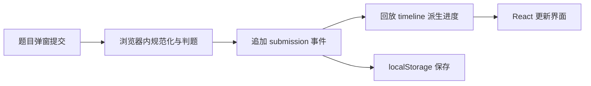
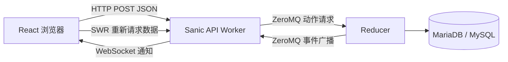

# 空悬蛛网参考站与 P&KU 平台源码核对

核对日期：2026-10-27。

## 1. 结论与证据范围

找到了两类不同的材料，不能把它们当成同一个部署版本：

1. 用户提供的 [空悬蛛网静态版](https://pnku3-day4-web.pkupuzzle.art/)：已下载并分析当前公开 HTML、JavaScript 和 CSS，能够确认题目弹窗、浏览器本地判题、事件回放和 localStorage 存档实现。
2. 官方组织公开的 [PKUPC/pnku-website](https://github.com/PKUPC/pnku-website)：包含可读的前端、后端、数据库结构和部署文档，可以核对完整活动平台的通信与状态架构。

本次核对公开平台仓库的版本为 [`b9fea7b3b317536790a67be4c9c096164e0de7e2`](https://github.com/PKUPC/pnku-website/commit/b9fea7b3b317536790a67be4c9c096164e0de7e2)。尚未找到静态版独立工程的公开源码仓库；其主脚本没有 `sourceMappingURL`，对应 `.js.map` 地址返回 404。

公开仓库的实现不等于当前活动网站的实际部署版本。不能凭这些材料断言其线上数据库、实例数量、运维配置或全部内部服务。

浏览器验证未完成：此前应用内浏览器能显示页面标题，但正文读取和截图超时。本轮原生浏览器工具因无法可靠识别当前网址而终止操作。因此本文的界面结论来自公开组件代码与 CSS，而不是已完成的目视验收；通信结论来自代码追踪，不是完整运行时抓包。

## 2. 静态版：前端怎样写

### 2.1 技术与页面组织

| 项目 | 已核对内容 | 证据 |
| --- | --- | --- |
| UI 框架 | React；产物包含 React DOM 18.3.1 标识 | 主脚本 renderer 信息与 `createRoot` |
| 组件库 | Ant Design 组件及图标 | `antd` 样式、组件配置、弹窗和消息组件实现 |
| 路由 | React Router；首页、`/web`、`/ending`、`/setting` | 主脚本中的路由表 |
| 状态 | React Context、useState、useMemo；由存档中的事件列表派生状态 | `i1e`、`o1e`、`Ed` 等压缩函数 |
| 题面 | 题目主内容以图片显示；图片从静态资源映射中取得 | `Xbe`、`Xl` |
| 剧情与提示 | 使用 Markdown 渲染，存在 HTML 处理插件 | `_M` 与相关渲染库 |
| 构建 | 有带哈希的资源文件与 modulepreload 兼容代码，符合 Vite 常见产物特征 | 这是推断；静态版没有可核对的 package.json |

主页面按章节排列题目卡片，有章节进度、折叠、剧情块和区域导航。它本身不是双角色方格地图游戏。

### 2.2 谜题弹窗的实际代码结构

在主脚本中，压缩名为 `Xbe` 的组件承担题目弹窗：

- 使用居中弹窗，配置宽度为 720px，没有默认底部按钮区。
- 顶部显示题名和状态标签，状态为通过、未通过或待提交。
- 有“题目”“提示”“提交记录”三个标签页。
- “题目”页上部为题面图片，下部为答案输入和提交区。
- 点击提交或在输入框按 Enter，先显示二次确认；确认后调用本地提交回调。
- 提交后清空该输入框，并显示消息和短暂的弹窗背景反馈。
- 提示页使用可展开的提示条目；提交记录以表格展示时间、内容、判定和信息。
- CSS 限制弹窗高度以适配视口；提示和记录区域独立滚动。
- 图片使用 `object-fit: contain`；桌面上限宽度为 440px，并按视口缩小。

这些是可从代码确定的结构参数。实际窗口遮挡、字体观感、小屏幕表现和加载后的图片清晰度，仍需要浏览器目视核对。

来源：[当前主脚本](https://pnku3-day4-web.pkupuzzle.art/assets/index-DvyLzUF_.js)、[当前样式表](https://pnku3-day4-web.pkupuzzle.art/assets/index-CVIsZind.css)。

## 3. 静态版：答案、存档与通信

### 3.1 答案处理链路

具体追踪结果：

- `uie` 检查题目是否已解锁、冷却条件和输入格式，创建带唯一 ID 的提交事件。
- `Ed` 从事件列表重新计算已解锁题、已通过题、剧情、提交记录和阶段等状态。
- `aie`、`nie`、`rie` 等函数在浏览器内进行普通答案与特殊阶段规则判定；相关题目数据也在产物中。
- `i1e` 维护 React 状态，存档变化后调用 `ik` 写入 localStorage。
- 本地存储键为 `pnku2026:day4-web-static:save:v1`；当前存档结构中的 `version` 为 2，不能把键名尾部 v1 当作结构版本。
- 导出通过 Blob 下载 JSON；导入读取用户选择的文件，进行结构与事件合法性验证后恢复。

它还包含多解、部分题目的成组判定与阶段条件。这些属于该套谜题的内容规则，不应自动加入我们的游戏。

### 3.2 通信能确认到什么程度

在当前完整主脚本中：

- `fetch(` 出现一次，用于 modulepreload 兼容逻辑加载资源。
- 未检出 `WebSocket`、`XMLHttpRequest`、`EventSource`、`socket.io`、`axios`、`sendBeacon` 或 Service Worker 调用。
- 已追踪的答题调用直接进入本地函数，不调用远端判题接口。
- 页面文字也明确说明进度只保存在当前浏览器，可用导入、导出迁移。

因此可判断：**这个静态版的核心答题和存档流程在客户端完成，没有从其公开代码发现双人房间同步或服务端判题。** 不应将其描述为“完全没有网络”：HTML、脚本、CSS、题图和字体仍通过 HTTP(S) 加载。

首页响应头显示 `Server: nginx`。这只能说明对外 HTTP 服务的一层标识，不能据此推断内部主机、数据库或完整部署结构。

### 3.3 与本项目的关键差异

静态版 `CA` 将题号加入已通过集合，后续错误提交不会按我们的规则将其删除；答案显示还存在状态颜色优先级。这与本项目“最后一次有效提交覆盖旧答案，改错就撤销解开状态”不同。

它也对部分重复答案作拒绝处理，并保留一个可选的错误冷却设置。本项目需要允许重新提交、没有游戏冷却，不能直接复用这些行为。

## 4. 公开完整平台：架构与通信

### 4.1 主要技术

| 层 | 公开仓库中的实现 |
| --- | --- |
| 前端 | TypeScript、React、Vite、Ant Design、React Router、SWR；另有 Tailwind 等依赖 |
| HTTP API | Python / Sanic，JSON 请求与响应 |
| 普通实时消息 | 浏览器原生 WebSocket，服务端按用户或队伍相关条件推送消息 |
| 协作题同步 | Yjs / y-websocket；Python 端处理对应协议，协作文档使用 LevelDB 持久化 |
| 核心状态 | Reducer 和多个 Worker；核心解题状态由事件驱动并在内存中计算 |
| 进程间通信 | ZeroMQ，动作使用 REQ/REP，事件使用 PUB/SUB |
| 数据库 | SQLAlchemy；文档建议 MariaDB，兼容 MySQL |
| 部署配置 | Nginx、Docker；公开仓库提供相关配置和部署说明 |

证据：[前端依赖](https://github.com/PKUPC/pnku-website/blob/b9fea7b3b317536790a67be4c9c096164e0de7e2/frontend/package.json)、[Sanic 入口](https://github.com/PKUPC/pnku-website/blob/b9fea7b3b317536790a67be4c9c096164e0de7e2/backend/src/api/app.py)、[开发文档](https://github.com/PKUPC/pnku-website/blob/b9fea7b3b317536790a67be4c9c096164e0de7e2/docs/development.md)。

### 4.2 答题与进度更新

1. 前端 `wish.ts` 把请求发送到 `/service/wish/…`，使用 POST、JSON 和带凭证的请求，并附带接口版本头。
2. 答案接口为 `POST /service/wish/puzzle/submit_answer`，检查身份、队伍、题目权限和输入等条件后创建内部动作。
3. Worker 通过 ZeroMQ 请求 Reducer；Reducer 保存对应队伍事件、提交数据库事务，递增状态计数并发出事件。
4. Worker 接收事件推进自己的状态；动作响应带有状态计数，Worker 等待自己追到该计数后继续响应。
5. 浏览器通过 `/service/ws/push` 接收 JSON 推送。比如提交相关通知会促使前端用 SWR 更新题目详情、提交记录和区域数据。

这套普通推送主要在通知前端“哪些数据要更新”，不等同于把角色坐标或整张地图状态作为连续游戏状态直接同步。

证据：[HTTP 客户端](https://github.com/PKUPC/pnku-website/blob/b9fea7b3b317536790a67be4c9c096164e0de7e2/frontend/src/logic/wish.ts)、[答案接口](https://github.com/PKUPC/pnku-website/blob/b9fea7b3b317536790a67be4c9c096164e0de7e2/backend/src/api/endpoint/wish/puzzle.py)、[Worker](https://github.com/PKUPC/pnku-website/blob/b9fea7b3b317536790a67be4c9c096164e0de7e2/backend/src/logic/worker.py)、[Reducer](https://github.com/PKUPC/pnku-website/blob/b9fea7b3b317536790a67be4c9c096164e0de7e2/backend/src/logic/reducer.py)、[浏览器推送客户端](https://github.com/PKUPC/pnku-website/blob/b9fea7b3b317536790a67be4c9c096164e0de7e2/frontend/src/logic/WsClient.tsx)。

### 4.3 协作题是另一条通道

`YClient.tsx` 创建 Y.Doc 和 y-websocket Provider，访问 `/service/sync/…`。后端检查玩家、队伍、题目解锁状态与该题是否启用协作，再以题目和队伍区分同步房间，处理增量更新与 awareness 消息。该通道的文档持久化由 LevelDBStore 处理。

证据：[Yjs 客户端](https://github.com/PKUPC/pnku-website/blob/b9fea7b3b317536790a67be4c9c096164e0de7e2/frontend/src/logic/YClient.tsx)、[协作题入口](https://github.com/PKUPC/pnku-website/blob/b9fea7b3b317536790a67be4c9c096164e0de7e2/backend/src/sync/endpoint/puzzle.py)、[协议处理](https://github.com/PKUPC/pnku-website/blob/b9fea7b3b317536790a67be4c9c096164e0de7e2/backend/src/sync/core/websocket_handler.py)、[协作存储](https://github.com/PKUPC/pnku-website/blob/b9fea7b3b317536790a67be4c9c096164e0de7e2/backend/src/sync/core/leveldb_store.py)。

本项目要求两人答案草稿和窗口独立，不需要因为参考平台存在 Yjs，就把个人答题框改成共同编辑。移动、推人、上锁和传送还需要统一判定，不能只靠协作文档合并解决。

## 5. 对本项目计划的落实

- 题面 UI 参考静态版的顶部题名与状态、主体题面、底部答案区；弹窗由每名玩家自己打开和关闭。
- 桌面可从约 720px 宽开始；我们的题面未必都是方形图片，保留长文、长图与滚动能力。
- 提示、二次提交确认、完整历史表不是原始必需功能，应单独标为可选，不能直接从参考站搬入需求。
- React 组件划分、内容与规则分离、状态由操作统一推导的思路值得参考。
- 保留 PLAN 中的服务端权威判题和房间状态设计；题目答案、解锁规则与推进不由两个客户端各自决定。
- 保留原计划的 TypeScript / Node.js / Socket.IO / PostgreSQL 作为当前建议，并未因找到参考仓库而自动改为 Python、ZeroMQ、Yjs 或 MariaDB。
- 必须重新实现答案覆盖、反向上锁、玩家受困、双人推动和配对传送；这些不是当前参考站已经具备且可直接套用的规则。
- 公开仓库 README 说明核心游戏逻辑基于事件状态机；实际数据库同时包含用户、队伍、题目等表，不能将所有存储简化为“数据库里只有事件”。

## 6. 本地材料与待核对项目

公开产物快照位于 `research/pnku3-reference/`：`index.html`、主脚本、主样式、`http-checks.json`、`analysis-evidence.json`。证据 JSON 记录了主脚本 SHA-256、网络相关标记计数以及已追踪函数的位置，方便后续复核。

尚未完成的事项：

- 题目弹窗、长图和窄屏的实际目视验证。
- 静态版独立工程的源码仓库和构建配置。
- 当前正式活动网站的部署版本与线上运行架构；公开平台源码只能证明该版本的设计。

本次没有向参考站提交谜题答案、修改其进度，或访问任何非公开后端数据。
